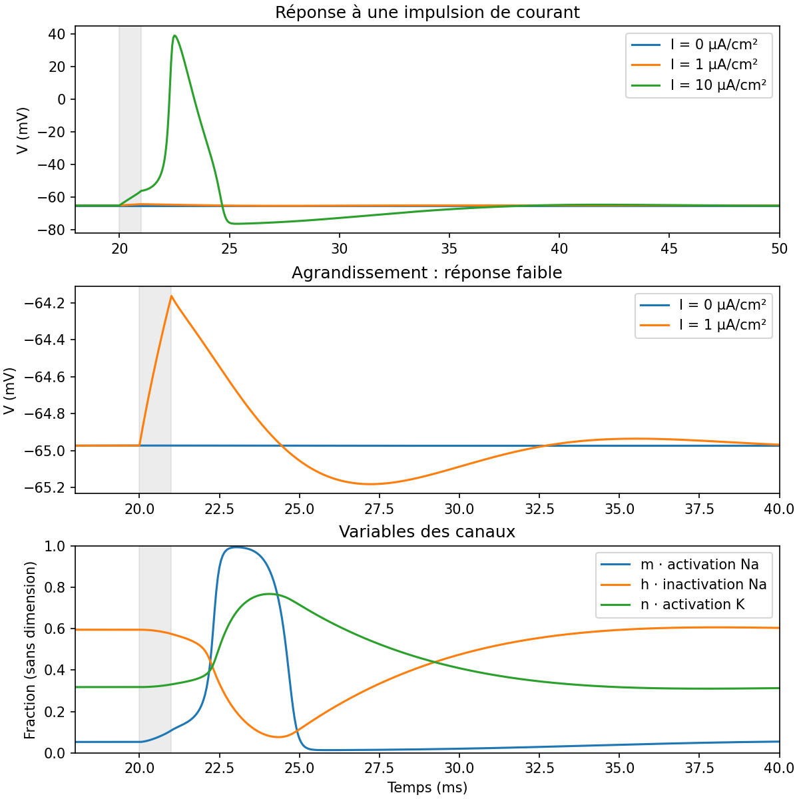
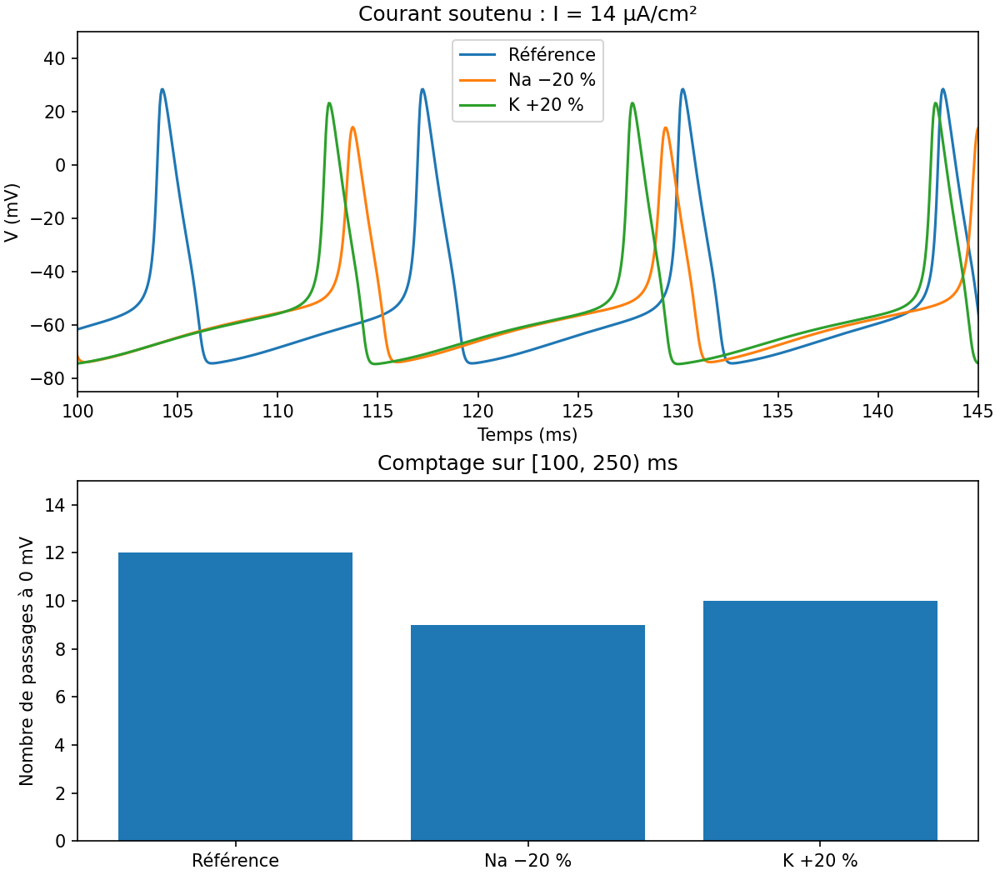

# Hodgkin–Huxley - Neuronal Excitability

Explore the Hodgkin–Huxley model and understand how sodium and potassium currents help produce action potentials.

I wanted to see how the strength of an injected current affects the membrane voltage and what happens when one of the ion conductances is changed.

## Model

We consider a uniform membrane at 6.3 °C, with membrane potential $V=\phi_{\mathrm{int}}-\phi_{\mathrm{ext}}$. The injected current is positive inward, while ionic currents are positive outward :

$$
C_m\frac{dV}{dt}=I_{\mathrm{ext}}-I_{\mathrm{Na}}-I_{\mathrm K}-I_L
$$

The sodium, potassium and leak currents are

$$
I_{\mathrm{Na}}=\bar g_{\mathrm{Na}}m^3h(V-E_{\mathrm{Na}})
$$

$$
I_{\mathrm K}=\bar g_{\mathrm K}n^4(V-E_{\mathrm K}),\qquad
I_L=g_L(V-E_L)
$$

The three gating variables $x\in\{m,h,n\}$ follow

$$
\frac{dx}{dt}=\alpha_x(V)(1-x)-\beta_x(V)x
$$

The reference parameters are:

- $C_m=1$ µF/cm²
- $\bar g_{\mathrm{Na}}=120$, $\bar g_{\mathrm K}=36$, $g_L=0.3$ mS/cm²
- $E_{\mathrm{Na}}=50$, $E_{\mathrm K}=-77$, $E_L=-54.3$ mV
- $V(0)=-65$ mV

## Project Structure

```text
hh.py                   HH equations, numerical solver and spike counting
experiences.py          two experiments and plots
tests/test_hh.py        basic mathematical and numerical tests
figures/impulsion.png   voltage responses and gating variables
figures/conductances.png conductance comparison
README.md               project description
requirements.txt        Python dependencies
.gitignore
```

## Run

Dependencies: Python 3.11 or newer, NumPy, SciPy, Matplotlib and pytest.

From the project root directory:

```bash
python -m pip install -r requirements.txt
python experiences.py
python -m pytest -q
```

The program saves two plots in `figures/`.

The equations are solved with SciPy's `solve_ivp` using DOP853 (an adaptive Runge–Kutta method of order 8). The simulation is split into three parts: before, during and after the current injection. The final state of each part is used to start the next one.

In `simuler`, `pas` (0.05 ms by default) sets the maximum spacing between output points. DOP853 chooses its internal steps automatically with a separate limit of `max_step=0.1` ms.

## Experiments

### 1. Current pulse

We apply three currents, 0, 1 and 10 µA/cm², during [20, 21) ms and simulate up to 60 ms.

The goal is to compare the voltage responses and look at how the gating variables $m,h,n$ change during a strong response.



### 2. Ion conductances

We apply a current of 14 µA/cm² during [50, 250) ms and simulate up to 300 ms.

Three cases are compared:

- Reference: $g_{\mathrm{Na}}=120$, $g_{\mathrm K}=36$ mS/cm²
- Sodium −20%: $g_{\mathrm{Na}}=96$, $g_{\mathrm K}=36$ mS/cm²
- Potassium +20%: $g_{\mathrm{Na}}=120$, $g_{\mathrm K}=43.2$ mS/cm²

We compare the voltage traces and count upward crossings of 0 mV during [100, 250) ms.

The results are 12 crossings for the reference, 9 with reduced sodium conductance and 10 with increased potassium conductance.



The upper plot shows the voltage between 100 and 145 ms. The bar chart uses the full counting window [100, 250) ms.

## What the Results Show

A weak current pulse stays below 0 mV while a stronger pulse produces an action potential. With a fixed injected current, changing the sodium or potassium conductance also changes the number of spikes.

The gating variables help explain the shape of the voltage response.

Spike counting counts upward crossings of 0 mV over a fixed time window.

## References

- A. L. Hodgkin and A. F. Huxley (1952), *A quantitative description of membrane current and its application to conduction and excitation in nerve*, Journal of Physiology, 117(4), 500–544. [DOI](https://doi.org/10.1113/jphysiol.1952.sp004764)
- NEURON 9.0.2, [`hh.mod`](https://github.com/neuronsimulator/nrn/blob/9.0.2/src/nrnoc/hh.mod), for the modern rate equations and conductance conventions. The reversal potentials are fixed parameters chosen for this project
- SciPy documentation: [`solve_ivp`](https://docs.scipy.org/doc/scipy/reference/generated/scipy.integrate.solve_ivp.html)
